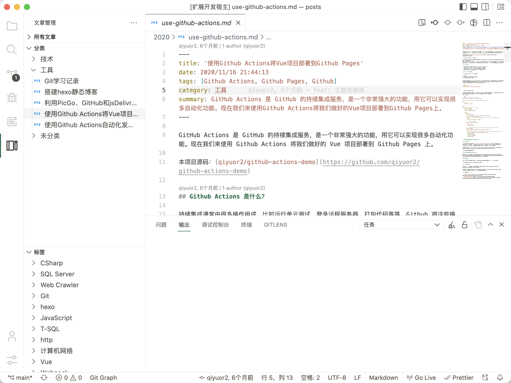

# Blog Manager

以更友好的方式将目录中的 markdown 文件列出，同时可以解析 front matter 中的分类和标签。侧边栏另有「按日期」视图（年 / 月 / 文章），默认读取 front matter 的 `date`，字段名可用 `bmConfig.group.dateField` 修改。

## TODO

- [x] 选择目录
- [ ] 拖拽调整
- [ ] 自定义分组条件
